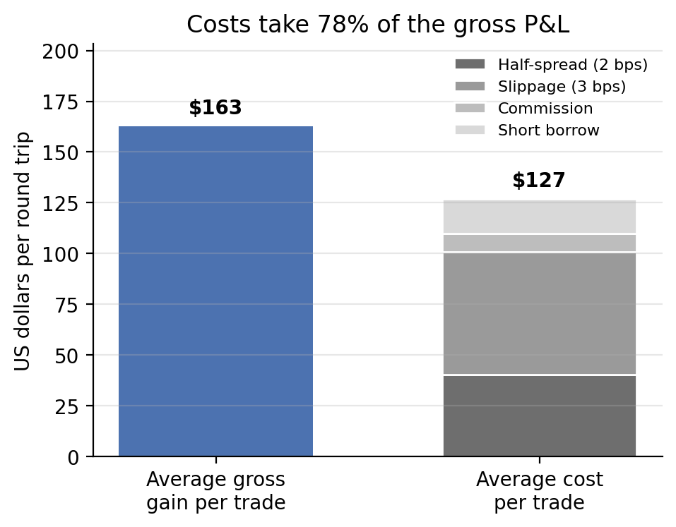
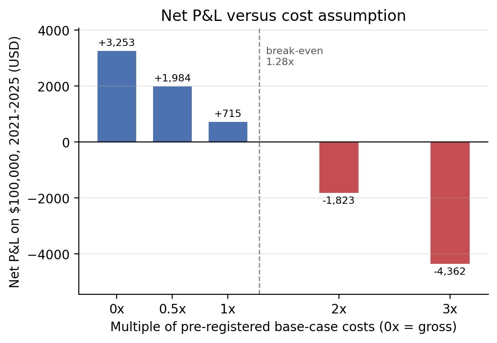
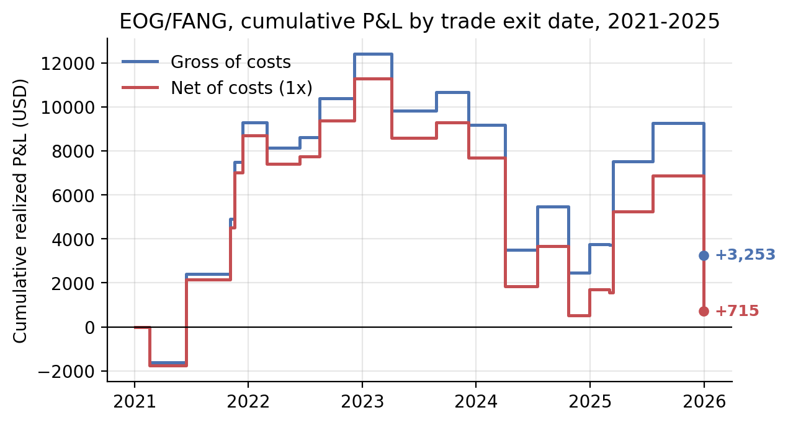

# Pairs Trading with Honest Cost Modeling: A Pre-Registered Case Study of How Transaction Costs Erode a Small Statistical-Arbitrage Edge

**Muhammad Mateen Iqbal**
BS Data Science, Institute of Computing & IT, University of Lakki Marwat, Pakistan
muhammadmateen1024@gmail.com

Working paper, version 1.0 — September 2026
Code, data manifest and full decision record: <https://github.com/mateeniqbal3/pairs-trading-honest-costs>

---

## Abstract

This paper measures how realistic transaction costs change the observed
performance of a simple cointegration-based pairs-trading strategy, using a
design in which every research choice (universe, sample split, selection
rule, signal thresholds, execution timing, accounting rules and cost model)
was recorded before any price data was downloaded. From all 28 pairs of
eight US oil and gas producers, the pre-registered rule selects EOG
Resources / Diamondback Energy (EOG/FANG), with a raw Engle-Granger p-value
of 0.0051. After Holm correction for 28 tests no pair is significant
(adjusted p = 0.142), and cointegration is not detected in the
out-of-sample period (p = 0.223). Traded out of sample over 2021–2025 with
\$100,000 of gross notional per trade, the strategy earns +3.25% gross
(Sharpe 0.08) and +0.72% net of costs (Sharpe 0.02) on the identical 20
trades, so costs consume 78% of the gross profit. The mechanism is
turnover: each round trip trades about \$202,000 of notional, so 5 bps per
side of half-spread and slippage alone costs about \$101 per trade, against
an average gross gain of \$163. The net profit disappears at 1.28 times the
base-case costs. Neither the gross nor the net return is statistically
distinguishable from zero. The contribution is methodological rather than
a new anomaly: a reproducible, audit-trailed template for separating gross
from net performance and for reporting a multiple-testing failure instead
of hiding it.

**Keywords:** pairs trading, statistical arbitrage, cointegration,
transaction costs, backtesting, multiple testing, pre-registration,
reproducibility

**JEL classification:** G11, G14, C12, C32

---

## 1. Introduction

Pairs trading is one of the oldest and most widely taught statistical
arbitrage strategies. The idea is simple: find two assets whose prices
share a long-run relationship, wait for the spread between them to move
unusually far from its norm, then buy the relatively cheap asset, sell the
relatively expensive one, and close the position when the spread reverts.
Because the idea is so simple, it is also easy to backtest badly. Three
problems appear again and again in informal backtests:

1. **Costs are ignored or added as an afterthought.** A strategy that
   trades frequently can look profitable gross of costs and lose money
   net of them.
2. **The pair is chosen by searching.** Testing many candidate pairs and
   keeping the best one makes the winner look more significant than it is.
3. **Future information leaks into the past.** Choosing the pair, fitting
   the hedge ratio or normalizing the signal on the same data that is then
   traded inflates performance.

This paper asks a narrow question: *how does incorporating realistic
transaction costs affect the observed performance of a pairs-trading
strategy?* It answers it for one pair, selected by a fixed rule, with the
gross and net results computed from the same trades. The gross result was
recorded and cryptographically hashed before any cost-model code existed,
so it could not be adjusted after the net result was seen.

The finding is that a small gross edge (+\$163 per trade, or 8.1 basis
points of the notional each trade turns over) is mostly consumed by a
modest cost model (about \$127 per trade, or 6.3 basis points), leaving a
net result that is positive but economically and statistically
indistinguishable from zero. The pair itself does not survive correction
for the 28 pairs that were searched.

None of this is a new empirical discovery. The sensitivity of pairs-trading
profits to trading costs is well documented (Section 2). The contribution
is a worked, fully disclosed example of doing the analysis honestly: every
decision is recorded as a dated decision record (ADR) in the repository,
every candidate pair is reported, the weak statistical evidence is stated
up front, and the published numbers can be reproduced exactly from a raw
data snapshot identified by its SHA-256 hash.

## 2. Related work

Gatev, Goetzmann and Rouwenhorst (2006) documented economically large
historical excess returns to a simple distance-based pairs rule in US
equities. Later work found that these profits declined over time and were
sensitive to how trading costs are modelled (Do and Faff, 2010, 2012).
Krauss (2017) reviews the main families of pairs-trading methods,
including the distance, cointegration, time-series and stochastic-control
approaches. The cointegration approach used here follows the two-step
procedure of Engle and Granger (1987) as popularized for trading by
Vidyamurthy (2004), with p-values from MacKinnon (2010).

More broadly, Novy-Marx and Velikov (2016) show that trading costs
substantially reduce the net returns of many published return anomalies,
especially high-turnover strategies. On the statistical side, Harvey, Liu
and Zhu (2016) argue that the large number of strategies tested in finance
requires much higher significance hurdles, and Bailey, Borwein, López de
Prado and Zhu (2014) show how backtest overfitting produces strategies
that fail out of sample. This paper applies the simplest version of that
discipline, a Holm (1979) correction over every pair tested, and borrows
the idea of pre-registration from the reproducibility literature (Nosek et
al., 2018).

## 3. Research design

All parameters below were fixed in the repository's `DECISIONS.md` on
2026-09-23 before any price data was downloaded (ADR-001 to ADR-004,
ADR-006 and ADR-007). Mechanical details that the original records left
open were fixed in later ADRs, each recorded before the step it governs
was run on real data (ADR-009 to ADR-011). No parameter was changed after
any result was seen.

### 3.1 Data and universe

The candidate universe is eight US-listed large-cap oil and gas producers:
XOM, CVX, COP, EOG, OXY, DVN, APA and FANG. Their revenues share a dominant
common driver (crude oil and natural gas prices), which is the standard
economic argument for why their prices might share a long-run stochastic
trend. Daily adjusted and unadjusted closing prices come from Yahoo Finance
via `yfinance` (version 1.7.0), from 2016-01-04 to 2025-12-31. Only dates
on which all eight stocks trade are kept; none were dropped, giving 2,514
trading days. No values are filled, interpolated or repaired. The raw
snapshot's SHA-256 hash is recorded in `data/dataset_manifest.json`.

The sample is split 50/50 by calendar year, as a rule rather than after
inspecting the data:

- **Formation period, 2016–2020 (1,259 days):** cointegration testing, pair
  selection and hedge-ratio estimation.
- **Trading period, 2021–2025 (1,255 days):** every reported performance
  number.

### 3.2 Pair selection and multiple testing

Each of the $\binom{8}{2} = 28$ pairs is tested with the Engle-Granger
two-step test on log adjusted closes over the formation period
(`statsmodels` `coint`, constant term, lag length by AIC). The dependent
variable is the alphabetically first ticker of each pair, an arbitrary
rule fixed in advance; the reverse ordering is reported as a robustness
check. The pre-registered selection rule is to trade the pair with the
lowest raw p-value. Raw, Holm-adjusted and Bonferroni-adjusted p-values are
reported for all 28 pairs (Appendix A).

A pre-registered *weak-relationship rule* required that, if the selected
pair did not survive Holm correction at 5%, this be reported as a finding
and raised before any backtest, and that the pair not be silently replaced.

### 3.3 Spread, signal and execution

The hedge ratio $\beta$ and intercept $\alpha$ come from an OLS regression
of $\log Y$ on a constant and $\log X$ over the formation period only, and
are held fixed for the whole trading period. The traded spread is

$$s_t = \log Y_t - \beta \log X_t - \alpha,$$

and its z-score uses a trailing 60-day window that ends at, and includes,
day $t$:

$$z_t = \frac{s_t - \bar{s}_{t-59:t}}{\hat\sigma_{t-59:t}}.$$

The strategy enters short-spread (short $Y$, long $X$) when $z_t \ge +2$
and long-spread when $z_t \le -2$. It exits a short-spread position when
$z_t \le +0.5$ and a long-spread position when $z_t \ge -0.5$, which also
covers the case where $z$ overshoots through the exit band in one day
(ADR-009). There is no stop-loss. A position decided at the close of day
$t$ is executed at the close of day $t+1$. Any open position is closed at
the final close of the trading period.

Each trade uses \$100,000 of gross notional, split between the legs in the
ratio 1 : $\beta$, in whole shares computed from the unadjusted close at
execution. Positions are not compounded. P&L uses dividend-adjusted
closes, so the short leg pays dividends and the long leg receives them.
Idle cash earns nothing. The Sharpe ratio is annualized with $\sqrt{252}$
over every trading-period day, including flat days, with a 0% risk-free
rate (ADR-006, ADR-010).

### 3.4 Transaction cost model

Costs are charged per leg, per order, to traded notional:

| Component | Base case | Basis |
|------|--------|-----------|
| Half bid-ask spread | 2 bps | Assumption for liquid US large caps |
| Slippage | 3 bps | Assumption for execution near the close at small size |
| Commission | \$0.005/share, \$1 minimum per order | Published fixed-rate broker schedule |
| Short borrow | 0.30% per year on short market value | General-collateral assumption |

These are assumptions, not measurements: daily Yahoo data contains no
quote information. Regulatory fees, market impact beyond slippage, borrow
recalls and margin interest are not modelled. Dividends paid on the short
leg are already inside gross P&L through the adjusted prices and are not
charged a second time. The net result is also reported at 0×, 0.5×, 2× and
3× the base case, with every component, including the commission minimum
and borrow rate, scaled together.

### 3.5 Bias controls and verification

**Look-ahead.** The pair and hedge ratio use formation data only; the
z-score uses only past and current values; and execution lags the signal
by one day. A unit test perturbs a single future price of either stock at
several dates and checks that every earlier z-score and position is
unchanged. Another test checks that trading-period prices cannot change
pair selection.

**Frozen gross result.** The gross backtest was run and its output file
hashed (SHA-256 `1acbfd35…df853`) before any cost code was written. The net
run reads the 20 frozen trades rather than regenerating them, verifies the
hash, rebuilds every trade's gross P&L to check it against the frozen
values, and confirms that 0× costs reproduce the gross result exactly
before applying costs (ADR-010, ADR-011). Two trades were also recomputed
independently from raw prices and match to the cent.

**Survivorship.** Not corrected; see Section 6.

## 4. Results

### 4.1 Pair selection

Five of the 28 pairs have a raw p-value below 0.05, against about 1.4
expected by chance if no pair were cointegrated. The tests are not
independent, since every pair shares the same oil-price factor, so this
count is only a rough guide.

| Rank | Pair (Y/X) | EG statistic | Raw p | Holm p | Hedge ratio $\beta$ |
|---:|---|---:|---:|---:|---:|
| 1 | **EOG/FANG** | −4.105 | **0.0051** | **0.142** | 0.742 |
| 2 | FANG/OXY | −3.950 | 0.0085 | 0.228 | 0.701 |
| 3 | APA/DVN | −3.484 | 0.0338 | 0.880 | 1.097 |
| 4 | EOG/OXY | −3.436 | 0.0385 | 0.962 | 0.527 |
| 5 | COP/CVX | −3.395 | 0.0429 | 1.000 | 1.446 |

*Table 1. The five pairs with the lowest raw p-values, formation period
2016–2020. The 5% critical value is −3.341. All 28 pairs are in Appendix A.*

The selected pair, EOG/FANG, is economically plausible: both are US shale
oil producers with large Permian Basin operations and exposure to the same
crude price, basin differentials and service-cost cycle. Statistically,
however, it does not survive correction: its Holm-adjusted p-value is
0.142, and no pair is significant at 5% after correction. The
weak-relationship rule was triggered. Following the pre-registered rules,
the project continued with EOG/FANG and disclosed the failure prominently
(ADR-008). Every result below should therefore be read as a test of a pair
*found by searching 28 candidates*, not of a statistically established
relationship.

The formation period is also unusual: it is dominated by the March 2020
crash, in which every ticker had its largest daily move.

### 4.2 Out-of-sample stability

Re-running the same Engle-Granger test on the trading period gives a
statistic of −2.638 and p = 0.223, so cointegration is not detected
out of sample. The hedge ratio itself is stable (0.742 in the formation
period, 0.754 in the trading period). A supplementary, non-pre-registered
ADF test on the spread actually traded (with the fixed formation
coefficients) gives p = 0.080: weak evidence of mean reversion, not
significant at 5%.

### 4.3 Gross versus net performance

| Metric (EOG/FANG, 2021–2025) | Gross of costs | Net of costs |
|---|---:|---:|
| Total P&L on \$100,000 | +\$3,253 | +\$715 |
| Total return | +3.25% | +0.72% |
| Annualized return | 0.65% | 0.14% |
| Annualized volatility | 8.29% | 8.29% |
| Sharpe ratio | 0.08 | 0.02 |
| Approximate t-statistic | 0.18 | 0.04 |
| Maximum drawdown | −11.35% | −12.28% |
| Win rate | 60.0% | 60.0% |
| Average P&L per trade | +\$163 | +\$36 |
| Round-trip trades | 20 | 20 (identical) |

*Table 2. Gross and net results from the same 20 trades. The approximate
t-statistic is the annualized Sharpe ratio times the square root of the
number of years (five).*

The strategy was in the market 44.7% of the time, held trades for 28.1
trading days on average, and turned over 8.1 times its capital per year.
Costs total \$2,538, equal to 78% of the gross P&L. The win rate does not
change because no winning trade was small enough to be turned into a loss
by its cost.

### 4.4 The mechanism: turnover against a thin edge

The cost drag is large even though the cost model is modest, because of
how much notional each trade moves. A round trip enters and exits both
legs, so a trade with \$100,000 of gross notional turns over about
\$202,000. At 5 bps per side for half-spread plus slippage, that alone costs
about \$101. Commissions add about \$9 and short borrow about \$17 over an
average 28-day hold, for about \$127 per trade.

*Figure 1. Average gross gain per round trip (\$163) against average cost
per round trip (\$127), by cost component.*

The useful way to see the result is per unit traded. The strategy's
average gross gain is 8.1 bps of the notional it trades; its cost is about
6.3 bps. The edge is only about 1.3 times the cost, which is why a
moderate error in the cost assumptions is enough to reverse the sign of
the result. Slippage (48% of costs) and half-spread (32%) dominate;
commission (7%) and borrow (14%) are secondary.

### 4.5 Sensitivity to the cost assumption

*Figure 2. Net P&L at each pre-registered cost multiplier.*

| Cost multiplier | 0× (gross) | 0.5× | **1× (base)** | 2× | 3× |
|---|---:|---:|---:|---:|---:|
| Total costs | \$0 | \$1,269 | \$2,538 | \$5,077 | \$7,615 |
| Net P&L | +\$3,253 | +\$1,984 | **+\$715** | −\$1,823 | −\$4,362 |
| Sharpe ratio | 0.08 | 0.05 | 0.02 | −0.04 | −0.11 |

*Table 3. Pre-registered cost sensitivity.*

Net P&L falls linearly in the cost multiplier and reaches zero at 1.28
times the base case. Because the base case is itself an assumption for
liquid large caps, a real-world cost only 28% higher than assumed, which
is well within the uncertainty of the estimate, eliminates the profit.

### 4.6 Trade-level behaviour

*Figure 3. Cumulative realized P&L, gross and net of base-case costs.*

Figure 3 shows that the result is not a steady accumulation of small
gains. Cumulative gross P&L peaked at about \$12,400 in December 2022 and was
then eroded by a small number of large losses. The two largest losses
(−\$5,674 and −\$6,014 gross) came from long-spread trades held 57 and 65
trading days while the spread kept diverging; the second was still open
at the end of the sample and was closed by the forced final exit. A
stop-loss would have limited these losses, but none was pre-registered,
and adding one after seeing these trades would be fitting the rule to the
result.

## 5. Discussion

The central lesson is about the ratio between edge and cost, not the level
of either. A backtest that reports only gross performance hides this ratio
entirely. Here, the gross result alone would already have been
unimpressive (Sharpe 0.08, t ≈ 0.18); the net result shows that even that
small edge is mostly a payment to liquidity providers under plausible
assumptions.

The second lesson is about search. Choosing the best of 28 correlated
tests produced a raw p-value of 0.0051 that looks convincing in isolation
and is not significant once the search is accounted for. The same
relationship was not detected in the following five years. A reader who
saw only the selected pair and its raw p-value would be badly misled.

The third lesson is procedural. Freezing the gross result before writing
cost code, reusing the identical trades for the net run, and verifying
both with hashes makes the gross-versus-net comparison auditable. The
design choices that constrain the analysis (no stop-loss, a single pair,
fixed thresholds) are limitations, but they are also what make the result
credible: nothing was tuned after the fact.

## 6. Limitations

- **Statistical power.** One pair and 20 trades over five years cannot
  establish or rule out a small edge. Neither the gross nor the net return
  is distinguishable from zero.
- **The pair was not statistically validated.** It failed Holm correction
  in the formation period and showed no cointegration out of sample.
- **Survivorship bias.** All eight tickers are listed today. Producers that
  were acquired or delisted during 2016–2025 (for example Anadarko, Noble
  Energy, Concho, Pioneer, Marathon Oil and Hess) are excluded, partly
  because free data for delisted tickers is unreliable. Choosing an energy
  universe also reflects general market knowledge.
- **Corporate actions.** Several firms completed large mergers during the
  sample, changing the businesses behind the tickers.
- **Assumed, not measured, costs.** Spread, slippage and borrow are
  assumptions. Market impact, regulatory fees, borrow recalls and margin
  interest are not modelled, and idle cash and short proceeds earn nothing.
- **No stop-loss and fixed parameters.** Thresholds (±2.0 entry, 0.5 exit,
  60-day window) are conventional, not tuned, and no sensitivity analysis
  over them was run.
- **Data.** Daily, free public data only. Yahoo revises adjusted history,
  so a fresh download may differ from the snapshot used here.
- **Generality.** A single pair in a single sector and period supports no
  claim about pairs trading in general.

## 7. Conclusion

Under a pre-registered design, a cointegration-based pairs trade in
EOG/FANG earned a small, statistically weak gross profit over 2021–2025,
and a modest, explicitly stated cost model removed 78% of it. The net
result disappears if costs are 28% higher than assumed. The selected pair
was the best of 28 searched candidates and did not survive correction for
that search. The practical conclusion is that the gross edge per unit
traded must be compared with the cost per unit traded before a
pairs-trading backtest is taken seriously, and that the full search
behind a selected pair must be disclosed.

A natural extension is to apply the same frozen-gross, pre-registered
protocol to a much larger universe of pairs across several sectors and
periods, including delisted firms, with costs estimated from quote data
rather than assumed.

## Data and code availability

All code, tests, decision records and generated results are available at
<https://github.com/mateeniqbal3/pairs-trading-honest-costs> under the MIT
License, and each release is archived on Zenodo (the DOI is listed in
the repository README). Raw prices are not
redistributed. The exact inputs and outputs are identified by SHA-256:

- Raw price snapshot: `59106b32a3e642f557cc0c66578c386bf7c6eb0f48e9ecb9b017aa7e570823e2`
- Frozen gross results (`docs/results_gross.json`): `1acbfd35e8c899173a6e4cb355942cc5485bf01d5ac5d0bfc419d429746df853`
- Net results (`docs/results_net.json`): `06540672fd0013278661e23f0e78996ba763b836e732a5a8a23d60db802e55ca`

The
full pipeline runs with `bash scripts/run_pipeline.sh`, and the figures in
this paper are produced by `python paper/make_figures.py` from the
committed result files only.

## Acknowledgements and AI-use disclosure

AI tools (Claude, Anthropic) were used to assist with parts of the
software implementation and with drafting and editing this write-up. All
research decisions, including the pre-registered design, were reviewed
and approved by the author, who takes full responsibility for the
content. Any errors are the author's own.

## References

Bailey, D. H., Borwein, J. M., López de Prado, M., and Zhu, Q. J. (2014).
Pseudo-mathematics and financial charlatanism: The effects of backtest
overfitting on out-of-sample performance. *Notices of the American
Mathematical Society*, 61(5), 458–471.

Do, B., and Faff, R. (2010). Does simple pairs trading still work?
*Financial Analysts Journal*, 66(4), 83–95.

Do, B., and Faff, R. (2012). Are pairs trading profits robust to trading
costs? *Journal of Financial Research*, 35(2), 261–287.

Engle, R. F., and Granger, C. W. J. (1987). Co-integration and error
correction: Representation, estimation, and testing. *Econometrica*,
55(2), 251–276.

Gatev, E., Goetzmann, W. N., and Rouwenhorst, K. G. (2006). Pairs trading:
Performance of a relative-value arbitrage rule. *Review of Financial
Studies*, 19(3), 797–827.

Harvey, C. R., Liu, Y., and Zhu, H. (2016). …and the cross-section of
expected returns. *Review of Financial Studies*, 29(1), 5–68.

Holm, S. (1979). A simple sequentially rejective multiple test procedure.
*Scandinavian Journal of Statistics*, 6(2), 65–70.

Krauss, C. (2017). Statistical arbitrage pairs trading strategies: Review
and outlook. *Journal of Economic Surveys*, 31(2), 513–545.

MacKinnon, J. G. (2010). Critical values for cointegration tests. Queen's
Economics Department Working Paper No. 1227, Queen's University.

Nosek, B. A., Ebersole, C. R., DeHaven, A. C., and Mellor, D. T. (2018).
The preregistration revolution. *Proceedings of the National Academy of
Sciences*, 115(11), 2600–2606.

Novy-Marx, R., and Velikov, M. (2016). A taxonomy of anomalies and their
trading costs. *Review of Financial Studies*, 29(1), 104–147.

Vidyamurthy, G. (2004). *Pairs Trading: Quantitative Methods and
Analysis*. Hoboken, NJ: John Wiley & Sons.

---

## Appendix A. Full pair-testing record (formation period 2016–2020)

Engle-Granger test on log adjusted closes, 1,259 observations per pair, 5%
critical value −3.341. Holm and Bonferroni adjustments are over all 28
tests. "Reverse p" swaps Y and X and was not used for selection.

| Rank | Pair (Y/X) | EG stat | Raw p | Holm p | Bonferroni p | $\beta$ | Reverse p |
|--:|------|---:|---:|---:|----:|---:|---:|
| 1 | EOG/FANG | −4.105 | 0.0051 | 0.1418 | 0.1418 | 0.7423 | 0.0036 |
| 2 | FANG/OXY | −3.950 | 0.0085 | 0.2283 | 0.2367 | 0.7012 | 0.0491 |
| 3 | APA/DVN | −3.484 | 0.0338 | 0.8795 | 0.9472 | 1.0970 | 0.0468 |
| 4 | EOG/OXY | −3.436 | 0.0385 | 0.9619 | 1.0000 | 0.5267 | 0.0824 |
| 5 | COP/CVX | −3.395 | 0.0429 | 1.0000 | 1.0000 | 1.4457 | 0.0081 |
| 6 | OXY/XOM | −3.324 | 0.0515 | 1.0000 | 1.0000 | 2.4336 | 0.0432 |
| 7 | FANG/XOM | −3.269 | 0.0591 | 1.0000 | 1.0000 | 1.7479 | 0.1663 |
| 8 | CVX/XOM | −3.156 | 0.0776 | 1.0000 | 1.0000 | 0.3662 | 0.9613 |
| 9 | CVX/OXY | −3.054 | 0.0980 | 1.0000 | 1.0000 | 0.1324 | 0.8973 |
| 10 | CVX/EOG | −2.837 | 0.1543 | 1.0000 | 1.0000 | 0.3232 | 0.9126 |
| 11 | CVX/FANG | −2.834 | 0.1550 | 1.0000 | 1.0000 | 0.2529 | 0.7540 |
| 12 | DVN/FANG | −2.834 | 0.1552 | 1.0000 | 1.0000 | 1.0396 | 0.4614 |
| 13 | CVX/DVN | −2.754 | 0.1806 | 1.0000 | 1.0000 | 0.1512 | 0.8579 |
| 14 | APA/XOM | −2.558 | 0.2539 | 1.0000 | 1.0000 | 2.2048 | 0.4849 |
| 15 | APA/OXY | −2.513 | 0.2736 | 1.0000 | 1.0000 | 0.8852 | 0.5581 |
| 16 | APA/FANG | −2.336 | 0.3558 | 1.0000 | 1.0000 | 1.1004 | 0.3150 |
| 17 | DVN/XOM | −2.304 | 0.3718 | 1.0000 | 1.0000 | 1.9490 | 0.5623 |
| 18 | DVN/OXY | −2.273 | 0.3869 | 1.0000 | 1.0000 | 0.7798 | 0.5610 |
| 19 | COP/OXY | −2.203 | 0.4226 | 1.0000 | 1.0000 | 0.2202 | 0.9567 |
| 20 | DVN/EOG | −2.032 | 0.5120 | 1.0000 | 1.0000 | 1.3795 | 0.6385 |
| 21 | EOG/XOM | −2.024 | 0.5162 | 1.0000 | 1.0000 | 1.2886 | 0.5895 |
| 22 | COP/FANG | −1.972 | 0.5433 | 1.0000 | 1.0000 | 0.3905 | 0.8980 |
| 23 | COP/DVN | −1.904 | 0.5780 | 1.0000 | 1.0000 | 0.2236 | 0.9153 |
| 24 | APA/EOG | −1.902 | 0.5792 | 1.0000 | 1.0000 | 1.4500 | 0.3635 |
| 25 | COP/EOG | −1.876 | 0.5922 | 1.0000 | 1.0000 | 0.5205 | 0.9637 |
| 26 | COP/XOM | −1.832 | 0.6142 | 1.0000 | 1.0000 | 0.5436 | 0.9697 |
| 27 | APA/CVX | −1.662 | 0.6942 | 1.0000 | 1.0000 | 1.0128 | 0.1810 |
| 28 | APA/COP | −1.583 | 0.7279 | 1.0000 | 1.0000 | 0.6140 | 0.4948 |

## Appendix B. Every trade, gross and net of base-case costs

Direction: +1 is long spread (long EOG, short FANG); −1 is short spread.

| # | Dir. | Entry | Exit | Gross P&L | Costs | Net P&L |
|--:|--:|-----|--------|-----:|----:|-----:|
| 1 | +1 | 2021-01-05 | 2021-02-18 | −\$1,617.94 | −\$144.11 | −\$1,762.06 |
| 2 | −1 | 2021-05-10 | 2021-06-16 | +\$4,037.10 | −\$131.27 | +\$3,905.83 |
| 3 | −1 | 2021-10-26 | 2021-11-03 | +\$2,491.93 | −\$112.61 | +\$2,379.31 |
| 4 | −1 | 2021-11-10 | 2021-11-17 | +\$2,591.44 | −\$112.05 | +\$2,479.39 |
| 5 | +1 | 2021-12-08 | 2021-12-14 | +\$1,793.81 | −\$108.65 | +\$1,685.17 |
| 6 | −1 | 2022-01-19 | 2022-02-28 | −\$1,147.73 | −\$132.68 | −\$1,280.41 |
| 7 | −1 | 2022-05-09 | 2022-06-14 | +\$459.74 | −\$133.69 | +\$326.06 |
| 8 | +1 | 2022-07-13 | 2022-08-17 | +\$1,770.23 | −\$130.45 | +\$1,639.78 |
| 9 | −1 | 2022-11-08 | 2022-12-07 | +\$2,022.30 | −\$111.63 | +\$1,910.67 |
| 10 | +1 | 2023-02-21 | 2023-04-04 | −\$2,574.13 | −\$124.46 | −\$2,698.59 |
| 11 | −1 | 2023-07-13 | 2023-08-25 | +\$837.25 | −\$132.31 | +\$704.93 |
| 12 | +1 | 2023-09-21 | 2023-12-07 | −\$1,478.54 | −\$134.28 | −\$1,612.82 |
| 13 | +1 | 2024-01-09 | 2024-04-02 | −\$5,673.51 | −\$150.48 | −\$5,823.98 |
| 14 | +1 | 2024-05-30 | 2024-07-15 | +\$1,955.74 | −\$125.59 | +\$1,830.15 |
| 15 | −1 | 2024-08-06 | 2024-10-23 | −\$3,007.57 | −\$145.09 | −\$3,152.66 |
| 16 | −1 | 2024-11-11 | 2024-12-30 | +\$1,283.92 | −\$123.47 | +\$1,160.44 |
| 17 | −1 | 2025-02-07 | 2025-03-03 | −\$25.09 | −\$114.94 | −\$140.03 |
| 18 | −1 | 2025-03-10 | 2025-03-14 | +\$3,811.20 | −\$111.15 | +\$3,700.05 |
| 19 | −1 | 2025-06-23 | 2025-07-21 | +\$1,737.63 | −\$118.90 | +\$1,618.73 |
| 20 | +1 | 2025-09-29 | 2025-12-31 (forced close) | −\$6,014.36 | −\$140.52 | −\$6,154.88 |
| | | | **Total** | **+\$3,253.41** | **−\$2,538.32** | **+\$715.09** |
